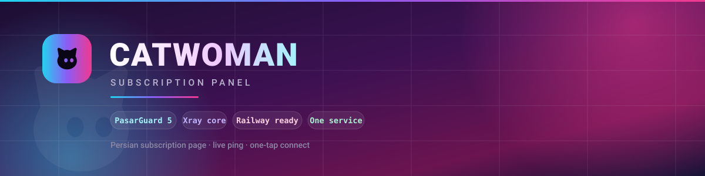

<div align="center">



### پنل اشتراک اختصاصی، آماده روی Railway

یک ریپو، یک سرویس: پنل **PasarGuard** با هسته‌ی **Xray**، روی **Railway** بالا می‌آید
و کانفیگ سالم تحویل می‌دهد — بدون سرور، بدون ترمینال، بدون تنظیم دستی.

</div>

---

## این ریپو چه کار می‌کند

روی Railway یک کانتینر بالا می‌آید که چهار چیز را با هم اجرا می‌کند و همه را خودش تنظیم می‌کند:
پنل، نود، هسته‌ی Xray و یک nginx جلوی همه.

اولین بار که سرویس بالا می‌آید، دیتابیس ساخته می‌شود، ادمین ساخته می‌شود، هسته و اینباند و نود
ثبت می‌شوند، و برند روی پنل و صفحه‌ی اشتراک گذاشته می‌شود. کاری که باید بکنی این است که
دکمه‌ی Deploy را بزنی.

## چه چیزی ساخته می‌شود

| | |
|---|---|
| نام گروه و اینباند | `𝗖𝗔𝗧𝗪𝗢𝗠𝗔𝗡` |
| نام هر کانفیگ | `𝗖𝗔𝗧𝗪𝗢𝗠𝗔𝗡 • <نام کاربر>` |
| عنوان پنل | `𝗖𝗔𝗧𝗪𝗢𝗠𝗔𝗡` |
| اعلان پنل | این پنل توسط Catwoman ساخته شده |
| پشتیبانی | [t.me/Catwoman_ZaHra](https://t.me/Catwoman_ZaHra) |
| کانال | [t.me/catwoman_panel](https://t.me/catwoman_panel) |

## صفحه‌ی اشتراک

صفحه‌ای که مشتری با باز کردن لینکش می‌بیند:

- کارت اشتراک با نام کاربر، وضعیت، روزهای باقی‌مانده و تاریخ شمسی
- مصرف حجم با نوار بخش‌بندی‌شده و درصد مصرف
- **پینگ زنده** — سه نمونه، بهترین عدد، با نمودار
- لینک اشتراک با دکمه‌ی کپی و کد QR
- کانفیگ‌ها با دکمه‌ی کپی و QR برای هر کدام
- **اتصال با یک لمس** — شش اپ (v2rayNG، Hiddify، V2Box، Streisand، NekoBox، Happ)
- آموزش اتصال در چهار مرحله
- دکمه‌ی اتصال سریع که همیشه در دسترس است

کل صفحه یک فایل است، حدود ۳۰ کیلوبایت، و **هیچ درخواستی به بیرون نمی‌زند** — نه فونت، نه عکس،
نه اسکریپت. پس پشت هیچ فیلتری سفید نمی‌ماند و هیچ سرور بیرونی نمی‌فهمد کسی این صفحه را باز کرده.

## شروع

۱. این ریپو را Fork کن.

۲. در [Railway](https://railway.com) → **New Project** → **Deploy from GitHub repo** → همین ریپو را انتخاب کن.

۳. یک **Volume** بساز و به سرویس وصل کن، با مسیر نصب:

```
/var/lib/pasarguard
```

۴. در تب **Settings → Networking** روی **Generate Domain** بزن.

۵. در تب **Variables** این‌ها را بگذار:

```
PUBLIC_HOST   = دامنه‌ای که در مرحله ۴ گرفتی
ADMIN_USERNAME = admin
ADMIN_PASSWORD = رمز خودت
TZ             = Asia/Tehran
```

۶. **Deploy** کن. اولین بیلد چند دقیقه طول می‌کشد چون Xray و نود دانلود می‌شوند.

۷. آدرس دامنه را باز کن و با `ADMIN_USERNAME` و `ADMIN_PASSWORD` وارد شو.

> **مهم:** رمز پیش‌فرض `admin` است و پنل هم آن را قبول می‌کند، ولی **قبل از دادن پنل به کسی عوضش کن.**
> اگر رمز تازه‌ات را در `ADMIN_PASSWORD` بگذاری، دفعه‌ی بعد که Deploy کنی خودش ست می‌شود.

## متغیرها

همه اختیاری‌اند. اگر خالی بمانی، مقدار پیش‌فرض می‌آید.

| متغیر | پیش‌فرض | کارش |
|---|---|---|
| `PUBLIC_HOST` | از `RAILWAY_PUBLIC_DOMAIN` | دامنه‌ای که در کانفیگ‌ها می‌آید |
| `PUBLIC_PORT` | `443` | پورت کانفیگ‌ها |
| `ADMIN_USERNAME` | `admin` | نام کاربری ادمین |
| `ADMIN_PASSWORD` | `admin` | رمز ادمین |
| `BRAND` | `CATWOMAN` | اسم برند |
| `SUB_SUPPORT_URL` | کانال پشتیبانی | لینک پشتیبانی |
| `SUB_ANNOUNCE` | اعلان پنل | متنی که بالای صفحه‌ی اشتراک می‌آید |
| `SUB_APPS` | `1` | با `0` کاشی‌های اپ ساخته نمی‌شوند |
| `TUNNEL_PATH` | `/ws` | مسیر WebSocket |
| `TZ` | `Asia/Tehran` | منطقه‌ی زمانی |

## فایل‌ها

| فایل | کارش |
|---|---|
| `Dockerfile` | تصویر پنل + nginx + Xray + نود |
| `entrypoint.sh` | ترتیب روشن شدن همه چیز |
| `bootstrap.py` | ساخت ادمین، هسته، نود، هاست، گروه و برند |
| `selftest.py` | تست خودکار تونل در هر بالا آمدن، نتیجه در لاگ Railway |
| `nginx.conf.template` | مسیر `/ws` برای تونل و بقیه برای پنل |
| `templates/subscription/` | صفحه‌ی اشتراک |

## نکته‌های راست و حسینی

- **Railway سرور نیست.** پورت ۴۴۳ فقط از راه لبه‌ی HTTP خودش کار می‌کند و UDP ورودی
  پشتیبانی نمی‌شود. برای همین اینجا یک پروتکل `VLESS + WebSocket + TLS` روی ۴۴۳ ساخته می‌شود
  که دقیقاً همان چیزی است که این محدودیت اجازه می‌دهد.
- **بیلد داکر روی محیط محلی تست نشده** — فقط روی خود Railway. اگر جایی گیر کرد، Issue بگذار.
- اگر دامنه را عوض کردی، `PUBLIC_HOST` را هم عوض کن و دوباره Deploy کن تا کانفیگ‌ها آدرس
  درست را بگیرند.

---

<div align="center">

**𝗖𝗔𝗧𝗪𝗢𝗠𝗔𝗡**

</div>
